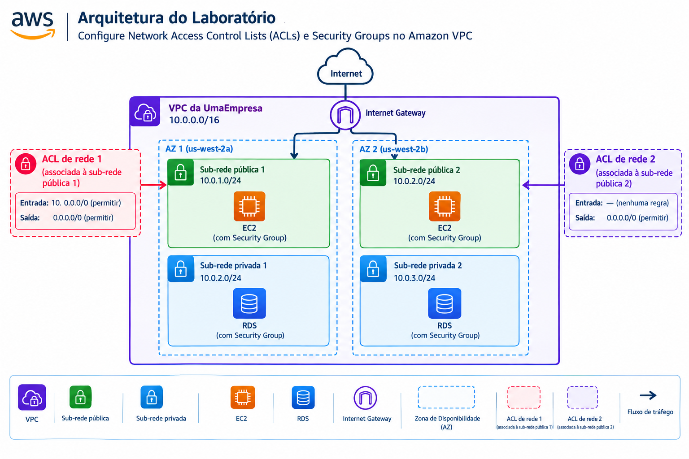

# AWS VPC Network Security Lab

Projeto prático de estudo sobre controles de segurança de rede na AWS, com foco em Network ACLs (NACLs), Security Groups e testes de conectividade em uma VPC.

> **Nota:** este repositório documenta um laboratório de aprendizagem. Consulte a seção de observações para diferenças entre o diagrama conceitual e uma configuração pronta para produção.

## Objetivo

Entender como os controles de segurança de rede atuam em diferentes níveis e como investigar falhas de conectividade em recursos de uma VPC.

## Arquitetura representada

A arquitetura conceitual apresenta:

- Uma VPC com faixa `10.0.0.0/16`.
- Duas zonas de disponibilidade.
- Sub-redes públicas com instâncias EC2.
- Sub-redes privadas com recursos RDS.
- Internet Gateway.
- Network ACLs associadas às sub-redes públicas.
- Security Groups associados às instâncias e aos bancos de dados.

## Conceitos praticados

### Security Groups

- São **stateful**: o tráfego de resposta de uma conexão permitida é autorizado automaticamente.
- Funcionam no nível das interfaces de rede dos recursos associados.
- Aceitam regras de permissão; não possuem regras explícitas de negação.

### Network ACLs

- São **stateless**: entrada e saída são avaliadas separadamente.
- São associadas a sub-redes.
- Permitem regras de entrada e saída de permitir ou negar.
- Para que uma comunicação funcione, as regras precisam permitir os fluxos necessários nos dois sentidos, incluindo portas efêmeras quando aplicável.

## Roteiro de validação

Use este roteiro ao reproduzir o laboratório na sua própria conta de treinamento:

1. Conferir a associação de cada Network ACL à sub-rede correta.
2. Revisar as regras de entrada e saída das ACLs, incluindo a regra final `*` que nega o tráfego não correspondido.
3. Conferir os Security Groups das EC2 e dos RDS, limitando o acesso às origens e portas necessárias.
4. Conferir as tabelas de rotas das sub-redes públicas e a rota para o Internet Gateway.
5. Confirmar que os recursos que precisam de acesso à internet têm endereçamento e rotas adequados.
6. Testar conectividade e registrar o resultado, horário, origem, destino e porta testada.
7. Se houver falha, investigar uma hipótese por vez: regras de segurança, rotas, endereçamento e serviço de destino.

## Observações importantes

- O diagrama é uma representação visual do laboratório, não uma exportação automática da configuração real da AWS.
- A faixa `0.0.0.0/0` representa todos os endereços IPv4. Regras amplas devem ser usadas somente quando necessárias ao objetivo do exercício.
- Uma ACL sem regra de entrada que corresponda ao tráfego bloqueará esse tráfego pela regra final `*`.
- A presença de recursos em sub-redes chamadas “públicas” ou “privadas” não determina sozinha sua exposição. Rotas, endereços públicos, Security Groups e ACLs também importam.
- O desenho mostra RDS em duas sub-redes; isso, por si só, não comprova que foi configurado um banco Multi-AZ.
- Não inclua neste repositório chaves, senhas, IDs de sessão, credenciais, endereços IP públicos sensíveis ou outros dados confidenciais.

## Tecnologias e serviços

- Amazon VPC
- Sub-redes e zonas de disponibilidade
- Internet Gateway
- Amazon EC2
- Amazon RDS
- Network ACLs
- Security Groups
- Testes de conectividade

## Aprendizados

- Diferenciar controles stateful e stateless.
- Entender que Security Groups e Network ACLs atuam em níveis diferentes e podem bloquear o mesmo fluxo.
- Verificar regras de retorno ao trabalhar com ACLs stateless.
- Usar uma sequência organizada de troubleshooting em vez de alterar recursos aleatoriamente.

## Próximos passos

- Documentar as regras efetivamente usadas no laboratório, sem publicar dados sensíveis.
- Adicionar capturas de tela sem credenciais ou identificadores confidenciais.
- Registrar os testes realizados e seus resultados.
- Revisar as regras para aplicar o princípio do menor privilégio.
